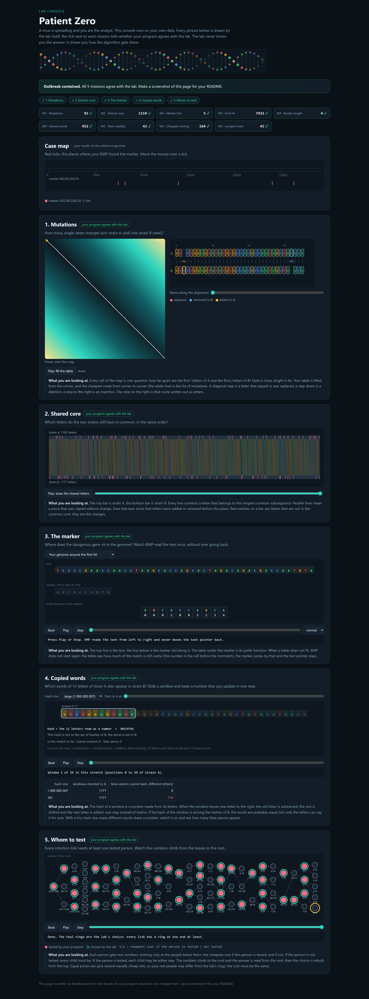

# Assignment 4. Patient Zero

Student ID: 250738
Name: Anas
Group: SE-2511

This file is the report. Fill it in as you go. How to start: `START_HERE.md`. The task: `docs/Assignment4.pdf`.

## Program output

The 9 lines your program prints on your data (`java -cp out Main`):

    Mutations: 92
    Shared core: 1119
    Marker hits: 5
    First hit: 7432
    Border length: 4
    Shared words: 452
    Tests needed: 42
    Cheapest testing: 164
    Longest chain: 42

My outbreak report (a screenshot of `output/outbreak.html`):

## Questions

Answer in your own words, two or three sentences each.

Mission 1. What does the cell d\[i][j] of your table mean, and how is it computed from other cells?

The cell `d[i][j]` represents the minimum number of single-letter changes
(insertions, deletions, or replacements) needed to turn the first `i` letters
of strain A into the first `j` letters of strain B.
It is computed by taking the minimum of three smaller cells:
`d[i-1][j-1]` (+0 if the letters `A[i-1]` and `B[j-1]` are equal, or +1 if replaced),
`d[i-1][j] + 1` (deleting a letter from A), and `d[i][j-1] + 1` (inserting a letter into A).

Mission 2. How is the longest common subsequence different from the longest common substring? My Shared core is bigger than the number of letters that are the same at the same place: why?

The longest common substring requires the matching letters to be contiguous with no gaps,
while the longest common subsequence allows gaps as long as the letters appear in the
same relative order.
My Shared core (1119) is larger than the number of identical letters at the exact same
position because insertions and deletions shift the indices of letters in strain B,
and LCS can still match those shifted letters across the gaps.

Mission 3. What does the prefix function tell you, and why does the pointer in the text never go back in KMP? What is the Border length of my marker and what does it mean?

For each prefix `p[0..i]` of the marker, the prefix function `pi[i]` tells us the length
of the longest proper prefix of `p[0..i]` that is also a suffix of `p[0..i]`.
Because `pi[k-1]` already knows how many characters at the end of our current match
also match the start of the marker, we only fall back in the pattern (`k = pi[k-1]`)
and never need to move the text pointer backward.
My marker's Border length is 4, which means the first 4 letters of my marker are
identical to its last 4 letters.

Mission 4. Why must you compare the letters after the hashes are equal? What happens to the cost of Rabin-Karp if many windows have the same hash?

Because the rolling hash is taken modulo `MOD`, two different 12-letter words can
produce the same remainder (a hash collision), so equal hashes do not prove that
the words are identical.
If many windows share the same hash, the algorithm has to compare all `k` letters
for many false alarms at each step, which slows the time down from `O(n + m)` on
average toward `O(n * m * k)` in the worst case.

Mission 5. What are the two states of a person in your DP, and how do you get the answer for a person from its children? Why does a greedy "test the person with most links first" not always give the cheapest answer?

For each person `u`, the two states are the minimum cost of `u`'s subtree when `u`
is tested (`take[u]`) and when `u` is not tested (`skip[u]`).
If `u` is not tested, every child `v` must be tested (`skip[u] = sum(take[v])`),
whereas if `u` is tested, each child can take the cheaper of its two states
(`take[u] = cost[u] + sum(min(take[v], skip[v]))`).
A greedy choice fails because a person with many links may have a much higher test
cost than their neighbours, or testing a central hub may still leave leaf links
uncovered that force us to test the neighbours anyway.

## AI use

Used an AI assistant (Gemini) to review the dynamic programming transitions,
verify the modular arithmetic for the Rabin-Karp rolling hash, and check the
complexity explanations.

## Timing (Mission 7)

Milliseconds, average of 3 runs, from `java -cp out Bench`.

| test          | size                     | time                                |
|---------------|--------------------------|-------------------------------------|
| naive search  | 20 000 / 40 000 / 80 000 | 67.3 ms / 116.7 ms / 219.8 ms       |
| KMP           | 20 000 / 40 000 / 80 000 | 2.6 ms / 1.5 ms / 0.4 ms            |
| edit distance | 500 / 1000 / 2000 / 4000 | 5.2 ms / 9.9 ms / 21.7 ms / 88.2 ms |

What do the numbers say about how the time grows? When you double the size, by how much does each time grow? Two or three sentences.

When the text length `n` doubles in part A, the naive search time roughly doubles
(`67.3 -> 116.7 -> 219.8 ms`) because it performs ~2000 character comparisons at
almost every position (`O(n * m)`), whereas KMP finishes in under 3 ms (even speeding
up from 2.6 ms to 0.4 ms after JVM JIT warm-up) because it runs in linear `O(n + m)` time.
In part B, once past the initial JVM warm-up on small sizes, doubling both strain
lengths from 2000 to 4000 quadruples the edit distance time (`21.7 ms -> 88.2 ms`,
about `4x`), which matches the quadratic `O(n * m)` table size.

## Complexity

n is the length of the text (or of a strain), m the length of the pattern, k the length of the window, v the number of people. Fill in every algorithm you wrote.

| algorithm                 | time                                   | space    | assumptions                                                                                                                                                    |
|---------------------------|----------------------------------------|----------|----------------------------------------------------------------------------------------------------------------------------------------------------------------|
| Edit distance             | O(n * m)                               | O(n * m) | `n` and `m` are the lengths of strains A and B; filling each cell of the `(n+1) x (m+1)` table takes `O(1)` time.                                              |
| LCS                       | O(n * m)                               | O(n * m) | `n` and `m` are the lengths of strains A and B; we allocate and fill an `(n+1) x (m+1)` table in `O(1)` per cell.                                              |
| Prefix function and KMP   | O(n + m)                               | O(m)     | Computing `pi` takes `O(m)` time and space, and scanning the text of length `n` increments and decrements `k` at most `n` times.                               |
| Rabin-Karp (shared words) | O((n + m) * k) avg, O(n * m * k) worst | O(m)     | Rolling the hash updates in `O(1)` per step; with few collisions we only compare `k` letters on real matches, and the hash map stores `O(m)` positions from B. |
| Tree DP                   | O(v)                                   | O(v)     | A tree has `v - 1` links, and the DFS visits every person and link a constant number of times using `O(v)` arrays and recursion stack.                         |

## Before you submit

- The four files in `data` and the screenshot `output/outbreak.png` are in the repository.
- `java tools/Check.java` shows all examples right.
- This README is filled in, the program output and the section AI use included.
- The work is pushed to main (at least one commit per mission) and the repository is public.
- The link is attached in Moodle.
